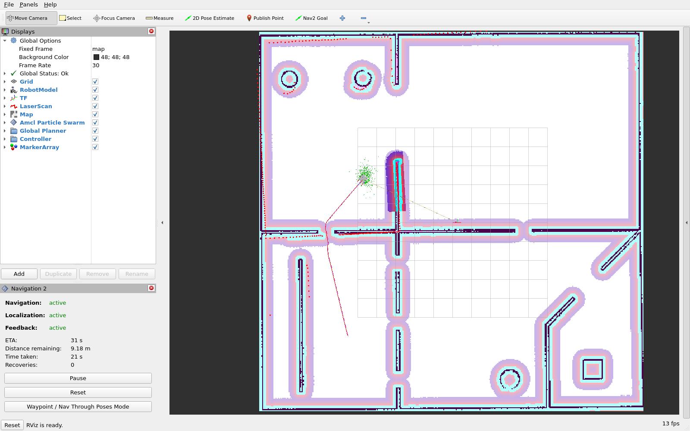
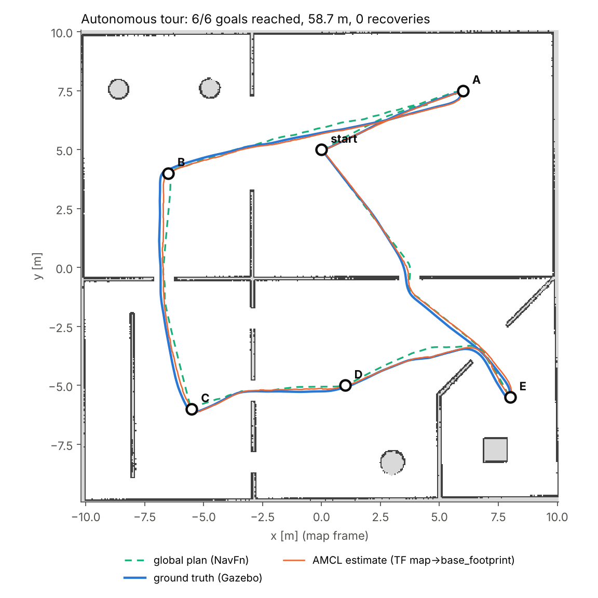
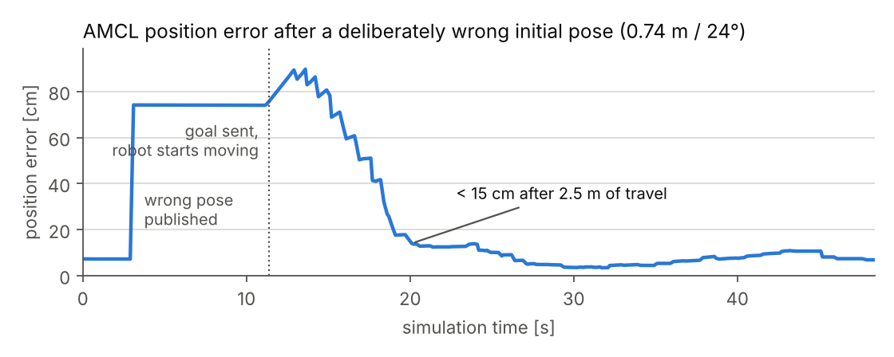

# testbed_navigation

Manual, modular Nav2 bring-up for the **Testbed-T1.0.0** differential-drive robot
(ROS 2 Humble, Nav2 1.1.x, Gazebo Classic 11). Instead of calling `nav2_bringup`,
every Nav2 server is started explicitly, with its own parameter file and launch file:

| Step | Launch file | Nodes | Parameters |
|---|---|---|---|
| 1. Map loading | `launch/map_loader.launch.py` | `map_server` + `lifecycle_manager_map` | `config/map_server_params.yaml` |
| 2. Localization | `launch/localization.launch.py` | `amcl` + `lifecycle_manager_localization` | `config/amcl_params.yaml` |
| 3. Navigation | `launch/navigation.launch.py` | `planner_server`, `controller_server`, `behavior_server`, `bt_navigator`, `waypoint_follower`, `velocity_smoother`, `collision_monitor` + `lifecycle_manager_navigation` | `config/nav2_params.yaml`, `behavior_trees/navigate_to_pose_testbed.xml` |
| all-in-one | `launch/testbed_navigation.launch.py` | steps 1-3 + RViz (optionally Gazebo too) | - |



## Package layout

```
testbed_navigation/
├── CMakeLists.txt            installs launch/ config/ behavior_trees/ rviz/ + scripts/send_goals.py
├── package.xml               exec_depends on every Nav2 server/plugin used
├── config/
│   ├── map_server_params.yaml
│   ├── amcl_params.yaml
│   └── nav2_params.yaml      planner, controller (DWB), costmaps, behaviors, BT, smoother, collision monitor
├── behavior_trees/
│   └── navigate_to_pose_testbed.xml
├── launch/
│   ├── map_loader.launch.py
│   ├── localization.launch.py
│   ├── navigation.launch.py
│   └── testbed_navigation.launch.py
├── rviz/testbed_navigation.rviz
├── scripts/send_goals.py     NavigateToPose action client (single goal or a tour of every room)
└── docs/                     screenshots and plots from the test runs
```

## Build

```bash
mkdir -p ~/assignment_ws/src && cd ~/assignment_ws/src
git clone <your-fork-url>
cd ~/assignment_ws
sudo apt install ros-humble-navigation2 ros-humble-gazebo-ros-pkgs ros-humble-xacro \
                 ros-humble-rmw-cyclonedds-cpp        # or: rosdep install --from-paths src -y --ignore-src
colcon build --symlink-install
source install/setup.bash
export RMW_IMPLEMENTATION=rmw_cyclonedds_cpp          # recommended in help.md
```

## Run - one step per terminal (recommended the first time)

```bash
# T1 - simulation (Gazebo + robot_state_publisher + spawn). use_rviz:=false avoids a 2nd RViz.
ros2 launch testbed_bringup testbed_full_bringup.launch.py use_rviz:=false
# T2 - step 1: map
ros2 launch testbed_navigation map_loader.launch.py
# T3 - step 2: localization
ros2 launch testbed_navigation localization.launch.py
# T4 - step 3: navigation
ros2 launch testbed_navigation navigation.launch.py
# T5 - RViz with the Nav2 panel
rviz2 -d $(ros2 pkg prefix testbed_navigation)/share/testbed_navigation/rviz/testbed_navigation.rviz \
      --ros-args -p use_sim_time:=true
# T6 - send goals (or use the "Nav2 Goal" button in RViz)
ros2 run testbed_navigation send_goals.py --goal 6.0 7.5 0
ros2 run testbed_navigation send_goals.py --tour
```

Or everything at once: `ros2 launch testbed_navigation testbed_navigation.launch.py with_sim:=true`.

Useful launch arguments: `map:=<yaml>` (map_loader), `with_map:=true` (localization),
`use_collision_monitor:=false` (navigation), `rviz:=false` (all-in-one), `gui:=false`
(Gazebo headless), `map_params_file / amcl_params_file / nav2_params_file:=<yaml>`.

## Design decisions

* **Frames.** `map` (map_server) -> `odom` (AMCL) -> `base_footprint` (Gazebo diff-drive)
  -> `base_link` -> sensors. The map origin `[-10.2, -9.94]` makes the map frame coincide
  with the Gazebo world (checked by overlaying the world's walls on the map,
  `docs/map_vs_world_overlay.png`), so the spawn pose (0, 5, 0) is AMCL's initial pose.
* **AMCL**: differential motion model, likelihood-field laser model, 500-2000 particles,
  `laser_max_range` matched to the (fixed) 12 m lidar, initial pose preset so the robot
  is localized as soon as AMCL activates.
* **Global planner: NavFn** (Dijkstra) - simple, robust, optimal on a 5 cm grid; the BT
  replans at 1 Hz.
* **Local planner: DWB** - samples (v, w) trajectories and scores them with critics; it
  does real local obstacle avoidance. Limits 0.30 m/s, 1.0 rad/s; acceleration limits
  identical to the velocity smoother so the controller's plans are trackable.
* **Costmaps**: rectangular footprint from the CAD meshes (0.37 x 0.43 m incl. padding),
  inflation 0.55 m (> circumscribed radius 0.27 m) with scaling 4.0 so the robot still
  fits through the 0.75-0.9 m doorways.
* **Behavior tree**: 1 Hz replanning + path following, with costmap clearing, spin, wait
  and back-up recoveries (`behavior_trees/navigate_to_pose_testbed.xml`).
* **Velocity pipeline**: controller/recoveries -> `cmd_vel_nav` -> velocity_smoother ->
  `cmd_vel_smoothed` -> collision_monitor -> `cmd_vel`. The collision monitor uses a
  direction-aware "approach" polygon (the robot footprint simulated forward 1 s) rather
  than a fixed "stop" box, which could freeze the robot next to a wall for good.
* **Unique parameter-file argument names** (`map_params_file`, `amcl_params_file`,
  `nav2_params_file`): included launch files share one launch-configuration scope, so if
  all three used `params_file` the first default would silently win in the all-in-one
  launch (this happened during testing: the controller got the map_server YAML and failed
  with "No critics defined for FollowPath").

## Results (headless Gazebo, sim time)

| Test | Result |
|---|---|
| Tour of all 5 rooms + return (`send_goals.py --tour`) | 6/6 goals SUCCEEDED, 58.7 m, 0 recoveries |
| Final pose error at each goal | <= 0.10 m, <= 6.3 deg (goal tolerance 0.10 m / 0.10 rad = 5.7 deg, measured just after the goal is declared) |
| Localization vs Gazebo ground truth during the tour | 6.1 cm mean after removing the map's constant 8 cm / 0.3 deg offset |
| AMCL started 0.74 m / 24 deg off | < 15 cm after 2.5 m of driving, 3.5 cm after 5.4 m |
| Variants: `with_sim:=true`, `with_map:=true`, `use_collision_monitor:=false` | all reach their goals |




## Challenges and how they were solved

1. **The starter code did not build** (CMake syntax), the map path was wrong and the
   map was never installed - see `../BUGS_FIXED.txt` for all 14 issues found.
2. **Robot turned 7 % less than commanded and drifted while spinning in place** - found
   with an open-loop drive test; caused by a wrong `wheel_separation` and a `base_footprint`
   that was not under the wheel axle.
3. **AMCL had little to work with** - the lidar range was 1.5 m in a 20 m world.
4. **Goals "succeeded" 0.2 m short** - the default goal tolerance (0.25 m) was loose; reduced
   to 0.10 m / 0.10 rad. Also `/amcl_pose` is only republished after the robot moves
   0.2 m / 0.2 rad, so the real pose must be read from TF (`map -> base_footprint`).
5. **Launch argument leakage** between included launch files (see design decisions).
6. **DDS discovery limits in containers/VMs**: with multicast unavailable, CycloneDDS
   allows ~10 participants by default and the 9th Nav2 process fails with
   "Failed to find a free participant index". A CycloneDDS XML with
   `<MaxAutoParticipantIndex>120</MaxAutoParticipantIndex>` and a localhost peer fixes it.
